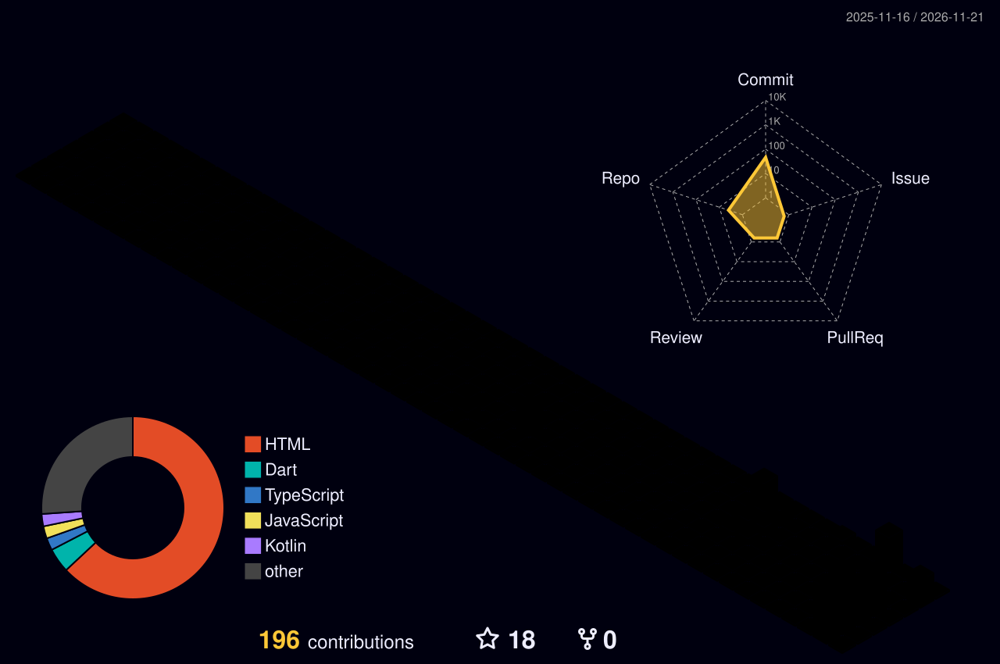

<!-- ===================== HERO (animated 3D neon banner) ===================== -->
<p align="center">

</p>

<p align="center">
<a href="https://git.io/typing-svg"></a>
</p>

<p align="center">
<a href="https://www.linkedin.com/in/suresh-vaishnav"></a>
<a href="https://github.com/SureshVaishnnav"></a>


</p>


## 👨‍💻 About Me

```kotlin
data class Developer(
    val name: String = "Suresh Vaishnav",
    val role: String = "Senior Mobile, AI & Full-Stack Developer",
    val codingSince: Int = 2020,
    val location: String = "Jodhpur, Rajasthan 🇮🇳",
    val mobile: List<String> = listOf("Android Native (Kotlin/Java)", "iOS (Swift)", "Flutter", "React Native"),
    val ai: List<String> = listOf("AI-powered apps", "LLM integrations", "Claude", "OpenAI Codex"),
    val web: List<String> = listOf("Next.js", "React", "TypeScript", "Node.js", "Websites"),
    val backend: List<String> = listOf("Firebase", "Oracle", "REST APIs", "Room / SQLite"),
    val aiTools: List<String> = listOf("Claude", "Codex", "Cursor", "Antigravity", "Orca", "VS Code"),
    val principles: List<String> = listOf("Clean Architecture", "SOLID", "MVVM"),
    val currentFocus: String = "Building Udhar Lo 💸"
)
```

<table>
<tr>
<td align="center" width="25%"><h1>📱</h1><b>Mobile Apps</b><br/><sub>Android Native, iOS, Flutter &amp; React Native apps shipped from idea to store</sub></td>
<td align="center" width="25%"><h1>🧠</h1><b>AI-Powered Apps</b><br/><sub>LLM integrations and AI-first dev workflows with Claude &amp; Codex</sub></td>
<td align="center" width="25%"><h1>🌐</h1><b>Web &amp; Full-Stack</b><br/><sub>Next.js websites, from landing pages to full-stack products</sub></td>
<td align="center" width="25%"><h1>🗄️</h1><b>Backend &amp; Data</b><br/><sub>Firebase, Oracle, SQLite/Room and REST APIs</sub></td>
</tr>
</table>

<p align="center">
🔭 Currently building <a href="https://github.com/SureshVaishnnav/Udhar_Lo"><b>Udhar Lo</b></a> &nbsp;•&nbsp; 🛠️ Open source: <a href="https://github.com/SureshVaishnnav/app-store-screenshots"><b>app-store-screenshots</b></a>, a 3D store mockup generator
</p>


## 🛠️ Tech Stack

<table align="center">
<tr><td align="center"><b>📱 Mobile</b></td><td></td></tr>
<tr><td align="center"><b>🌐 Web</b></td><td></td></tr>
<tr><td align="center"><b>🔥 Backend &amp; Cloud</b></td><td> </td></tr>
<tr><td align="center"><b>🧰 Tools</b></td><td></td></tr>
</table>

<h3 align="center">🧠 AI &amp; AI Coding Tools</h3>
<p align="center">


</p>


## 🌌 3D Contribution Universe

<p align="center">

</p>


## 📊 GitHub Analytics

<p align="center">

</p>
<p align="center">


</p>
<p align="center">

</p>
<p align="center">

</p>


## 🗺️ Journey

| Year | Milestone |
|---|---|
| 🌱 **2020** | Started professional development with **React Native** |
| 🤖 **2021+** | Went deep into **Android Native** (Kotlin/Java, Room, MVVM) and **Flutter** |
| 🍎 **Later** | Expanded to **iOS** plus **Next.js** websites and full-stack work |
| 🧠 **Now** | Building **AI-based apps** and shipping faster with Claude, Codex, Cursor & Antigravity |


## 🚀 Featured Projects

| Project | Description | Stack |
|---|---|---|
| ⚡ **[app-store-screenshots](https://github.com/SureshVaishnnav/app-store-screenshots)** | Open-source App Store & Google Play screenshot generator with 3D mockups |  |
| 💸 **[Udhar Lo](https://github.com/SureshVaishnnav/Udhar_Lo)** | My current product in active development |  |
| 🎬 **[Movies_Hub](https://github.com/SureshVaishnnav/Movies_Hub)** | Flutter app on TMDB API with trending, top rated & watch-list suggestions |  |
| 📒 **[Ok-Credit-Clone](https://github.com/SureshVaishnnav/Ok-Credit-Clone)** | Native Android ledger app clone |  |
| 🛒 **[React-E_commrce-with-chat](https://github.com/SureshVaishnnav/React-E_commrce-with-chat)** | E-commerce web app with real-time chat |  |
| 🗄️ **[Room-Database](https://github.com/SureshVaishnnav/Room-Database)** | Android Room persistence sample |  |


## 🐍 Contribution Snake

<p align="center">
<picture>
<source media="(prefers-color-scheme: dark)" srcset="https://raw.githubusercontent.com/SureshVaishnnav/SureshVaishnnav/output/github-contribution-grid-snake-dark.svg"/>
<source media="(prefers-color-scheme: light)" srcset="https://raw.githubusercontent.com/SureshVaishnnav/SureshVaishnnav/output/github-contribution-grid-snake.svg"/>

</picture>
</p>

<p align="center">
<i>"Clean code always looks like it was written by someone who cares."</i>
</p>


